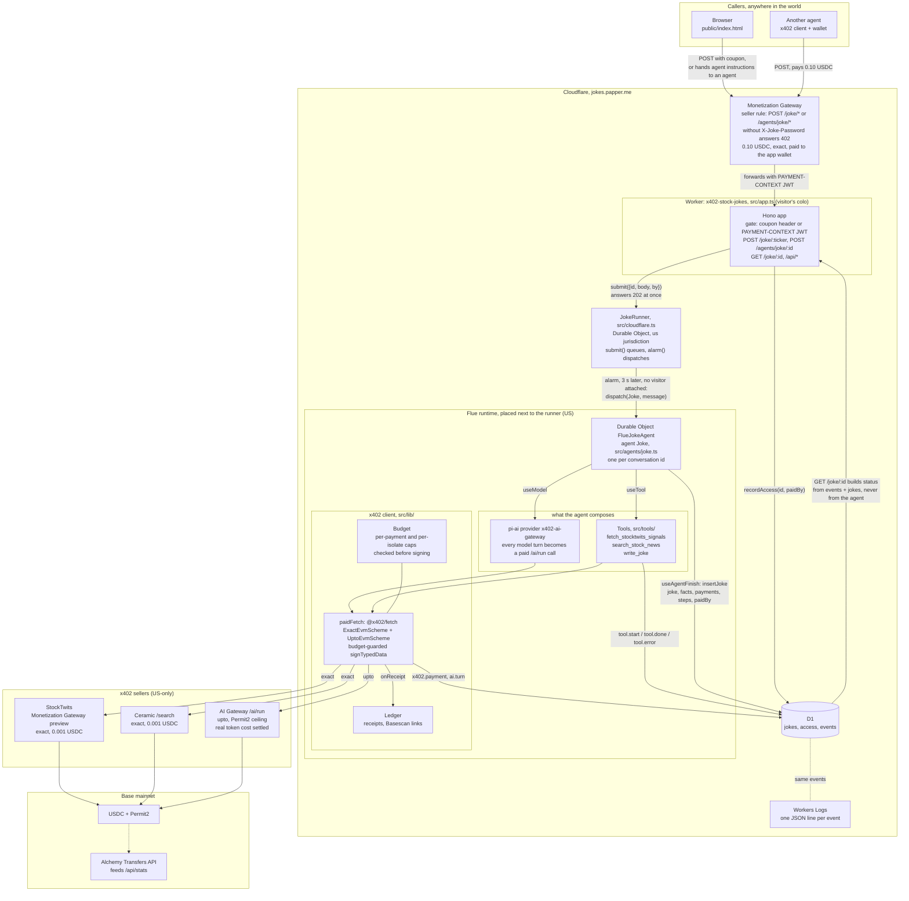
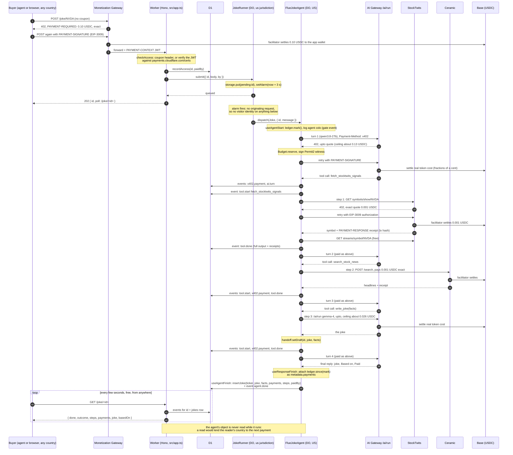
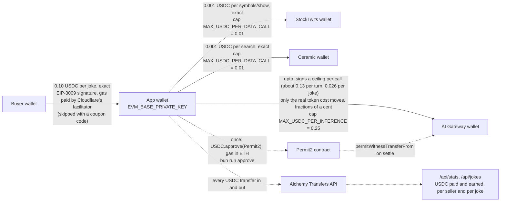

# x402 Stock Jokes

One joke per ticker, and every step of making it is an **x402 micro-payment in USDC on Base**. No API keys for the data or the model, just a wallet. Live at **https://jokes.papper.me**.

```
"Tell me a joke about TSLA"
  → 1. StockTwits   GET symbols/show/TSLA (+ the free symbol stream)   0.001 USDC, exact
  → 2. Ceramic      POST /search "Tesla TSLA stock news"              0.001 USDC, exact
  → 3. AI Gateway   POST /ai/run google/gemma-4-26b-a4b-it            ≤ 0.026 USDC ceiling, upto
  and the agent's own turns on alibaba/qwen3.8-27b, also via AI Gateway x402 (≤ 0.13 USDC ceiling each)
```

Built with [Flue](https://flueframework.com) (Cloudflare's agent framework) on Workers, Durable Objects and D1, the [x402](https://x402.org) TypeScript client, and three sellers behind Cloudflare's [Monetization Gateway](https://blog.cloudflare.com/monetization-gateway-beta/) / [AI Gateway machine payments](https://developers.cloudflare.com/ai-gateway/features/machine-payments/). The app is itself an x402 seller: submitting a joke without the password costs 0.10 USDC through the Monetization Gateway.

A real run (2026-10-16):

> NVDA is currently trading at $214.85, and people are losing their minds. One trader is out here questioning if the stock even looks good at that price, while analysts are dreaming of a $10 trillion market cap. I don't know about $10 trillion, but with 671,863 people watching it, it's definitely the most popular kid in school.
>
> Based on: NVDA traded at $214.85 on StockTwits with 671,863 people on its watchlist; an analyst sees about 31% upside and TipRanks asks if Nvidia can hit a $10 trillion market cap by 2030.
> Paid: StockTwits 0.001 USDC [tx](https://basescan.org/tx/0x23107b86878bb565e6f0adfec8ea5e699267417e3401ac67fd086be98dea9b9a), Ceramic 0.001 USDC [tx](https://basescan.org/tx/0xfc277a0f2047ef062676926562a67b377dcd93876f86a74d09ed2a0aabe10c7a), AI Gateway joke ≤ 0.0258 USDC

## Architecture

Three views of the same system: what runs where, what happens during one joke, and where the USDC goes. One constraint shapes the first two: Cloudflare's gateways are US-only and judge the *visitor* whose request is in flight, so every paid call is made from a Durable Object that was started by an alarm, with no visitor attached, and nothing reads that object while it works (see [Where the agent runs](#where-the-agent-runs-and-why-it-matters)).

### Components



### Lifecycle of one joke



### Flow of funds



**Reading the diagrams.** The buyer's 0.10 USDC lands in the same wallet the agent spends from, so sales top up costs. Every outgoing payment passes one signer, wrapped so the `Budget` is consulted before any signature exists: a payment over the per-call cap, or over the isolate total (`MAX_USDC_PER_ISOLATE`), is refused with no money moved. `exact` payments return a `PAYMENT-RESPONSE` receipt with the transaction hash; `upto` payments do not, so the page matches AI Gateway settlements to a joke by time window from the wallet's on-chain history. The runner and the agent are two Durable Objects: the runner only queues and fires an alarm, the agent does all the paying, and the Worker that serves `GET /joke/<id>` reads the `events` and `jokes` tables rather than the agent, so a poll from outside the US cannot attach itself to a payment in flight.

## How the money moves

| Step | Seller | Scheme | What you sign | Gas |
|---|---|---|---|---|
| 1, 2 | StockTwits, Ceramic (Monetization Gateway) | `exact` | USDC EIP-3009 `transferWithAuthorization` for exactly the quoted price | none, the facilitator pays |
| 3 and agent turns | Cloudflare AI Gateway `/ai/run` | `upto` | Permit2 `permitWitnessTransferFrom` for a *ceiling*; the actual token cost is settled | none per call, but one on-chain `USDC.approve(Permit2)` first |
| Submitting a joke to *this* app | jokes.papper.me (Monetization Gateway) | `exact` | 0.10 USDC, unless you send the password | none |

The Flue agent's own model turns pay too: `src/lib/ai-gateway-provider.ts` is a pi-ai provider whose fetch rewrites each chat-completions call into the AI Gateway `/ai/run` envelope with `Payment-Method: x402`, pays the 402, and replays the completed result as a stream.

Spend caps and model choices are plain-text vars in `wrangler.jsonc`, enforced *before* anything is signed (`src/lib/budget.ts`). Every payment is recorded with its Basescan receipt, attached to the reply, and stored with the joke in D1.

| Var (`wrangler.jsonc` → `vars`) | Default | Meaning |
|---|---|---|
| `ORCHESTRATOR_MODEL` | `alibaba/qwen3.8-27b` | the agent's own model; must be one of the four AI Gateway machine-payment models |
| `JOKE_MODEL` | `google/gemma-4-26b-a4b-it` | the model `write_joke` pays for |
| `MAX_USDC_PER_DATA_CALL` | `0.01` | cap per StockTwits or Ceramic payment (they quote 0.001) |
| `MAX_USDC_PER_INFERENCE` | `0.25` | cap per AI Gateway authorization ceiling (Qwen quotes about 0.13) |
| `MAX_USDC_PER_ISOLATE` | `5` | total one Worker isolate may authorize before it refuses |

They apply in `bun run dev`, in production, and in the scripts, which read `wrangler.jsonc` too. `.dev.vars` holds only the secrets.

## Who can submit a joke

Submitting a joke (`POST /joke/<TICKER>` or `POST /agents/joke/<id>`) spends real money, so it needs one of:

- a coupon code, in the `X-Joke-Password` header (or `?password=`), stored as the `JOKE_PASSWORD` secret; or
- an x402 payment of **0.10 USDC** to the app, handled by Cloudflare's Monetization Gateway in front of `jokes.papper.me`. The gateway answers the first request with a real x402 `402` quote, verifies the signed USDC authorization on the retry, and forwards the request with a signed `PAYMENT-CONTEXT` JWT that the Worker verifies against `https://payments.cloudflare.com/certs` (`src/lib/access.ts`).

Neither present: the gateway answers `402` with the x402 quote (and, off the gateway, the Worker answers `402` with instructions and the latest cached joke). Reading a conversation or a joke status (`GET`), the feed and the stats are always free.

**Simple API for agents:** `POST https://jokes.papper.me/joke/NVDA` (no body) returns `202 { id, poll }`; `GET` the `poll` URL until `done` is true to get `joke`, `basedOn`, `steps` and `payments`. Full instructions, including the x402 flow and a TypeScript example, are served at [jokes.papper.me/agent.md](https://jokes.papper.me/agent.md); the page's "Copy instructions for my agent" button copies them with the ticker filled in.

Gateway rule on the `papper.me` zone (dashboard, or `cf monetization rules update`; the API form is a Wirefilter expression):

```
http.host eq "jokes.papper.me" and starts_with(http.request.uri.path, "/agents/joke/")
  and http.request.method eq "POST" and not len(http.request.headers["x-joke-password"]) > 0
```
Fixed price `$0.10` (`exact`), audience Everyone, receiving wallet = the app wallet, so revenue tops up what the app spends. The rule matches both `/agents/joke/` and `/joke/` and charges whenever the header is *absent*; the Worker checks the header's *value*, so a wrong coupon code is a 401, not a free ride.

Verified 2026-10-16: an unpaid POST gets the gateway's 402 with a 0.10 USDC quote; `bun scripts/pay-for-joke.ts TSLA` from a second wallet paid it ([tx](https://basescan.org/tx/0x140f1cc2580e8a7771d6e55e5cd248715bc7ade6142549174c775df32634725c)), the Worker accepted the signed `PAYMENT-CONTEXT`, and the joke was stored with `paidBy: "x402"`. Paying from the app's own wallet is refused by the facilitator ("facilitator rejected verify request"), so use a different wallet to test.

## Where the agent runs, and why it matters

Monetization Gateway and AI Gateway machine payments are US-only, and they evaluate the country of the **visitor whose request is in flight** when the Worker pays, not the account, the wallet, or the datacenter. Cloudflare carries that identity down the whole request chain, and a Durable Object attributes its outbound calls to whichever incoming request is active. So the path is built to keep every visitor out of the paying code:

1. The entry Worker (any colo, any visitor) only checks the coupon or the gateway's payment and **queues** the message into `JokeRunner`, a Durable Object in the `us` jurisdiction (`src/cloudflare.ts`).
2. The runner's **alarm**, which has no originating request, dispatches the agent 3 s later. The agent's Durable Object is placed next to the runner (ORD so far) and every paid call leaves from there with no visitor attached.
3. **Nothing reads the agent's object.** Tools and the agent log progress to D1 (`events`), the finished joke goes to D1 (`jokes`), and `GET /joke/<id>` is served from D1. Conversation reads (`GET /agents/joke/<id>`, streams) answer 403 to everyone; abort needs the coupon header.

Verified with a Canadian VPN: submit, poll every 2 s, full run, all payments 200. The `gate` events record visitor country, runner and agent colo for every run. Full write-up and bug report: [docs/ai-gateway-visitor-country.md](./docs/ai-gateway-visitor-country.md).

## Logging and reporting gateway bugs

Every gateway interaction is logged as one JSON line (Workers Logs) and stored in the D1 `events` table:

- `x402.payment`: one per paid call, with every HTTP attempt (the 402 quote with its `cloudflare-quote` JWT claims, the `PAYMENT-SIGNATURE` we sent minus the signature bytes, the final status, the decoded `PAYMENT-RESPONSE`), the upstream ids (`cf-ray`, `cf-aig-request-id`, `cf-aig-event-id`, `cf-aig-trace-id`, `cf-auditlog-id`), payer, amounts, and timings.
- `gate`: each admission or denial with visitor country/colo, the verified `PAYMENT-CONTEXT` claims and key id for x402 payers, plus the runner's and agent's colo probes.
- `ai.turn`: each orchestrator model turn with usage, finish reason and ids.
- `error`: tool failures at agent finish.

Read them with `GET /api/events?conversation=<id>`, `?failures=1`, `?kind=x402.payment`, `?since=<iso>`, or live with `bunx wrangler tail x402-stock-jokes --format json`. To report a bug to Cloudflare, send the event JSON for the conversation: it has the `cf-ray` and `cf-aig-*` ids, the quote `jti`, the payer address, the tx hash and the exact timestamps. `GET /api/_trace` shows what a subrequest from the Worker looks like to Cloudflare-fronted endpoints.

## The page

`public/index.html`, no framework. You enter a ticker, nothing else. Every joke card's StockTwits, Ceramic and AI Gateway badges expand into an "under the hood" panel with that service's full response, the facts passed to the model, the payment, and links to the conversation JSON and the x402 gateway events; the same works on the live run's step rows. Jokes made before the step archive existed show a note instead. The 402 card then offers two paths: copy the agent instructions (your agent pays 0.10 USDC with x402), or type a coupon code for a free joke; a working coupon is remembered in the browser. The run shows each of the three steps and the agent's turns with receipt chips, then the joke and the facts behind it. Below: a live feed of every joke ever made (polled from D1 every 3 s), counters, and a jokes-per-hour sparkline.

**Money numbers come from the chain, not from estimates.** Every x402 payment is a USDC transfer out of the app wallet, so `/api/stats` reads the wallet's USDC history through Alchemy's Transfers API (`ALCHEMY_API_KEY`) and reports **USDC paid on-chain** per seller and the number of x402 jokes sold (from the gateway's `PAYMENT-CONTEXT` amounts). The `upto` scheme never moves the authorized ceiling: AI Gateway settles only the real token cost, within seconds of each call. StockTwits and Ceramic amounts are matched to each joke by transaction hash; AI Gateway settlements by a time window around the joke (so concurrent jokes can share a settlement).

## Setup

Requirements: [Bun](https://bun.sh), a Cloudflare account with AI Gateway machine payments and Monetization Gateway enabled (US, card on file), and about $2 of USDC plus $0.25 of ETH on **Base mainnet**.

```sh
bun install
cp .dev.vars.example .dev.vars
```

Fill `.dev.vars`:

- `CLOUDFLARE_ACCOUNT_ID`: `cf accounts list` or `bunx wrangler whoami`.
- `CLOUDFLARE_API_TOKEN`: a token with **Account › Workers AI › Read** (and AI Gateway › Run). Example via the `cf` CLI, after `cf auth login`:
  ```sh
  cf user tokens create --name x402-stock-jokes --policies '[{"effect":"allow","resources":{"com.cloudflare.api.account.<ACCOUNT_ID>":"*"},"permission_groups":[{"id":"a92d2450e05d4e7bb7d0a64968f83d11","name":"Workers AI Read"},{"id":"644535f4ed854494a59cb289d634b257","name":"AI Gateway Run"}]}]'
  ```
- `EVM_BASE_ADDRESS` / `EVM_BASE_PRIVATE_KEY`: `bun run wallet:new` creates a dedicated wallet, or paste your own. Keep only a few dollars in it.
- `JOKE_PASSWORD`: the coupon code that lets friends skip the paywall.
- `ALCHEMY_API_KEY`: an [Alchemy](https://www.alchemy.com) app key with Base Mainnet enabled, for the wallet's USDC history (`/api/stats`, `/api/transfers`).

Then:

```sh
bun run approve            # one-time USDC.approve(Permit2) on Base, needs a little ETH
bun run doctor             # balances, allowance, and the three live 402 quotes
bun run db:migrate:local   # D1 schema for the local dev database
```

## Run locally

```sh
bun run dev       # http://localhost:5173
```

Open the page, type a ticker and the password, watch the three steps pay and complete. Or use the agent API directly:

```sh
curl -X POST http://localhost:5173/agents/joke/demo-1 \
  -H 'content-type: application/json' -H 'x-joke-password: <JOKE_PASSWORD>' \
  -d '{"kind":"user","body":"Tell me a joke about NVDA."}'

curl http://localhost:5173/joke/demo-1                  # status from D1: steps with outputs, payments, joke
curl http://localhost:5173/api/jokes?limit=10           # feed, newest first (add &after=<iso> for updates)
curl 'http://localhost:5173/api/jokes/latest?ticker=NVDA'
curl http://localhost:5173/api/stats                    # count, tickers, USDC authorized, per-hour buckets
curl http://localhost:5173/api/wallet                   # address, USDC balance, Permit2 status
```

Conversation reads are not public (they would lend the reader's location to in-flight payments); `/joke/<id>` is the status API. `bun scripts/pay-for-joke.ts NVDA` pays the app from `BUYER_PRIVATE_KEY` (or the app wallet) and prints the joke; the core of it:

```ts
import { x402Client } from "@x402/core/client";
import { ExactEvmScheme } from "@x402/evm/exact/client";
import { wrapFetchWithPayment } from "@x402/fetch";
import { privateKeyToAccount } from "viem/accounts";
const client = x402Client.fromConfig({ schemes: [{ network: "eip155:8453", client: new ExactEvmScheme(privateKeyToAccount(KEY)) }], spendControls: { maxAmountPerPayment: "$0.25" } });
const fetchWithPayment = wrapFetchWithPayment(fetch, client);
await fetchWithPayment("https://jokes.papper.me/agents/joke/my-id", { method: "POST", headers: { "content-type": "application/json" }, body: JSON.stringify({ kind: "user", body: "Tell me a joke about NVDA." }) });
```

## Deploy

```sh
bunx wrangler login
bun run db:migrate                  # D1 schema (once per migration)
bun run deploy                      # vite build && wrangler deploy; creates the jokes.papper.me custom domain
# upload the six secrets (a JSON object of name → value; keep the file out of git):
bunx wrangler secret bulk secrets.json --name x402-stock-jokes
```

`cf deploy` does not understand Flue's Vite build output yet, so deploy goes through wrangler. Everything else (login, tokens, D1 creation) works with the `cf` CLI.

## What's inside

```
src/app.ts                     routes: the access gate, /joke/<TICKER> + /joke/<id> (simple API), /agents/joke, /api/jokes, /api/stats, /api/transfers, /api/events, /api/_trace, /api/wallet; registers the x402 provider
src/cloudflare.ts              JokeRunner: us-jurisdiction Durable Object that starts every conversation
src/lib/log.ts                 structured events (Workers Logs + D1), upstream id extraction
src/agents/joke.ts             Joke: the Flue agent, its model and tools, payment metadata on every reply, D1 write on finish
src/tools/stocktwits.ts        step 1 (paid symbols/show + free stream → price, bull/bear counts, sample posts)
src/tools/ceramic.ts           step 2 (paid search → headlines)
src/tools/joke.ts              step 3 (paid /ai/run → the joke)
src/lib/x402.ts                one x402 client (exact + upto), budget-guarded signer, receipt decoding
src/lib/ai-gateway-provider.ts the agent's model, paid with x402 through AI Gateway
src/lib/access.ts              password or Monetization Gateway PAYMENT-CONTEXT check
src/lib/db.ts                  D1: jokes (insert, feed, per-ticker latest, stats) and access (how each conversation was admitted)
src/lib/transfers.ts           the wallet's USDC transfers from Alchemy: USDC paid per seller, earned, per-joke settled amounts
src/lib/budget.ts, ledger.ts   spend caps, payment records
public/index.html              the page
migrations/                    D1 schema
scripts/                       wallet:new, approve, doctor, pay-for-joke
```

Models: the orchestrator is `alibaba/qwen3.8-27b` (best multi-step tool use of the four machine-payment models) and the joke writer is `google/gemma-4-26b-a4b-it` (top of the four on creative-writing benchmarks). Both are thinking models; the joke call turns thinking off via `chat_template_kwargs.enable_thinking=false`, while the orchestrator keeps it on (without it Qwen asked for ticker confirmation instead of calling tools; the price is a slow final turn). Change either model in `wrangler.jsonc` vars.

Cost per joke: about 0.002 USDC for data plus a few thousandths of a USDC settled for inference. AI Gateway quotes a *ceiling* per call against the model's full context window (about 0.13 USDC per Qwen turn, 0.026 per Gemma call), so the wallet must hold roughly 0.5 USDC of headroom even though far less is charged.

## Operational notes

- **Wallet headroom.** One joke reserves roughly 0.55 USDC in flight while a few thousandths settle. Keep at least 1 USDC in the wallet or the facilitator refuses with `verify returned 403`.
- **AI Gateway settles per call, on-chain, for the real token cost** (fractions of a cent, never the ceiling), but returns no `PAYMENT-RESPONSE` receipt. `/api/transfers` lists the settlements.
- **Secrets are read lazily on purpose.** Workers validate the module at upload time before any secret exists, so nothing in `src/lib/` touches a secret at import. Keep it that way when adding code, or `wrangler deploy` fails with error 10021.
- **Base RPC rate limits.** Public Base RPCs return 429 to Cloudflare's edge under light load; `/api/wallet` rotates through several and falls back to address-only. Set `BASE_RPC_URL` for the scripts if `mainnet.base.org` throttles you locally.
- **Reply format drift.** The orchestrator sometimes writes `Based:` instead of `Based on:`; the page accepts both. The D1 row uses the facts passed to `write_joke`, not the reply text.
- **`cf workers secrets bulk` did not set secrets** in this session (it reported success, then `secrets list` was empty); see [docs/cf-secrets-bulk-bug.md](./docs/cf-secrets-bulk-bug.md). `wrangler secret bulk` works.
- **`503 facilitator verify returned 403` / `403 disallowed visitor country`** were the visitor-identity check described above, not flakiness; the alarm-driven runner plus D1-served status fixes them. `write_joke` still retries once on a 5xx.
- **Only `write_joke` may produce the joke.** The agent is told it cannot write jokes itself and may call a tool at most twice per reply; an earlier version retried a failing joke call seven times.
- **Only one hostname.** Adding the custom domain turned off the `workers.dev` route (requests there get Cloudflare error 1042). Everything, including the password path, goes through `jokes.papper.me`.
- **Admission is recorded in D1**, not in memory: the HTTP gate and the agent's Durable Object are different isolates, so `access` rows carry `paid_by` across.
- **Renaming the agent** renames its Durable Object class; `wrangler.jsonc` carries a `renamed_classes` migration (`FlueStockJokeAgent` → `FlueJokeAgent`) so existing conversations survive.

## Caveats

- StockTwits' x402 preview serves only `GET /api/2/symbols/show/{SYM}.json`; the price and sentiment numbers come from the free `streams/symbol` endpoint on the same gateway. The preview is staging, geo-fenced, and has no SLA.
- AI Gateway `/ai/run` does not stream under x402 and returns no `PAYMENT-RESPONSE` receipt; the page shows those rows as ceilings.
- Tool-calling orchestration on an open 27B model is good, not perfect. The agent is instructed to call all three tools in order and to only output jokes that came from step 3.

See [PLAN.md](./PLAN.md) for the design, the research behind it, and what was verified live.
